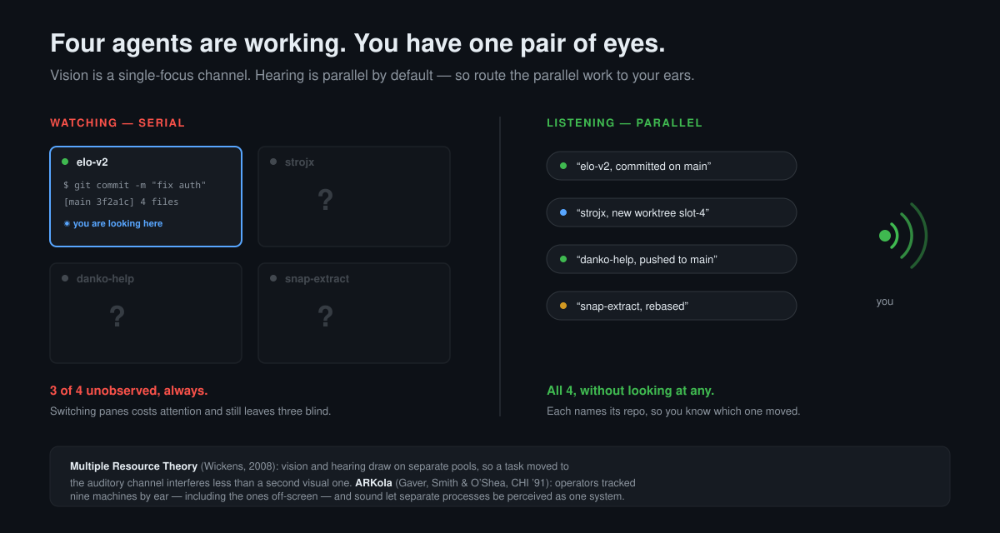

# dopamine-git

**Hear what your agents did to your repos.**

Your AI agents don't report to you. Your git does.



---

## The problem

You're running four coding agents across four repos. You can look at one pane at a
time. The other three are doing things to your code that you will find out about
later, in a diff, at the worst possible moment.

Every other audio tool for this hooks *the agent* — Claude Code's "task finished",
Cursor's "needs permission". Two problems with that:

- **It's one integration per agent, forever.** New tool next month? Write another.
- **It reports what the agent claims, not what happened.** "Done!" is self-reported.
  A commit landing is ground truth.

dopamine-git listens to **git itself**, one layer below all of them. Anything that
runs `git` — any agent, any script, any teammate over SSH, any cron job — is heard,
with zero integrations written.

And it tells you **which repo**. A generic chime across four worktrees is noise.
*"elo-v2, pushed to main"* is information.

## Install

```bash
git clone https://github.com/ghostON3/dopamine-git
cd dopamine-git && ./install.sh
```

Then make a commit. You'll hear it.

Needs `bash` and an audio player (`pw-play`, `paplay`, `afplay`, `ffplay`, `play`,
or `aplay` — you almost certainly have one). Voice mode needs
[piper](https://github.com/rhasspy/piper); without it, everything falls back to
sounds automatically.

```bash
sfx doctor     # tells you exactly what's missing and what's silent
```

## Swap the sound pack

A pack is **a folder of audio files named after events**. That's the entire format.

```bash
sfx pack list           # what's installed
sfx pack use zelda      # switch
sfx pack dir zelda      # where it lives, to edit it
```

### Make your own in about a minute

```bash
sfx pack init mine
cp ~/Downloads/pentakill.mp3 "$(sfx pack dir mine)/push.ogg"
sfx pack use mine
```

Done. No manifest, no build step, no registry, no JSON required. The filename *is*
the configuration:

```
mine/
  push.ogg           plays on a successful push
  commit.mp3         plays on a commit
  test-pass/         a folder = one picked at random each time
    a.wav
    b.wav
  merge-1.ogg        numbered variants work too
  merge-2.ogg
```

`.ogg` `.oga` `.mp3` `.wav` `.opus` `.flac` `.m4a` all work. Anything missing
falls back to the default pack, so a half-finished pack still makes noise.

You can also rip clips straight into a pack:

```bash
sfx add push "https://youtube.com/watch?v=..." --start 0:12 --end 0:14
```

> **On game and movie audio:** it stays on your machine. The bundled default pack
> is synthesized from oscillator math (`tools/gen-tones.sh`) precisely so this repo
> ships nothing it doesn't own. Your Zelda pack is yours; please don't PR the audio.
> Link your pack repo in [PACKS.md](docs/PACKS.md) instead.

## Voice, sound, or silence — per event

The default is **voice**, because with four repos in flight you need to know *which*
one moved:

```
"danko-help, committed on main"
"elo-v2, new worktree slot-4"
```

Speech is piper TTS, cached to disk — 1.2s the first time, 0.015s every time after.

```bash
sfx events                  # every event, its mode, its phrase
sfx mode commit voice       # speak it
sfx mode checkout sound     # just a tone
sfx mode add off            # silence
```

`add` and `fetch` ship **off** on purpose. Agents fire them constantly and a
narrating terminal gets unbearable inside two minutes.

Phrases are templates. `[...]` marks a clause that disappears when empty, so an
unborn branch doesn't produce "pushed to HEAD":

```
phrase.commit={repo}, committed[ on {branch}]
```

## Why ears

This isn't a novelty. It's a documented way to get capacity back.

**[Multiple Resource Theory](https://journals.sagepub.com/doi/10.1518/001872008X288394)**
(Wickens, 2008) — attention isn't one pool. Vision and hearing draw on separate
resources, so two tasks competing for *the same* modality interfere far more than
two split across modalities. Monitoring four panes is four tasks fighting over one
visual channel. Moving status to audio moves it to a channel you have sitting idle.

**[ARKola](https://www.semanticscholar.org/paper/Effective-sounds-in-complex-systems:-the-ARKOLA-Gaver-Smith/92ea5784efd995b959dea903134da85e793c9ce3)**
(Gaver, Smith & O'Shea, CHI '91) — operators ran a simulated bottling plant of nine
interconnected machines, most off-screen at any moment. With sound, they tracked
processes they weren't looking at, caught failures sooner, and — the striking part —
perceived the separate machines as *one system*.

That study is 35 years old and describes your terminal exactly. Nine machines you
can't all watch is four agents you can't all watch.

The dopamine part is real too, just less rigorous: a clean, immediate reward on
commit makes committing feel good, and things that feel good happen more often.
Good git hygiene as a habit loop rather than a discipline problem.

## How it works

A `git` shim earlier in your `PATH` than the real one. It classifies the
subcommand, runs the real git untouched, and announces on success.

Why not git hooks? **Git has no hook for `add` and no hook for `worktree`** — two of
the things you most want to hear. And why not a shell function? Because that lives
only in your interactive shell:

```bash
$ zsh -c 'type git'
git is /usr/bin/git        # your agents sail straight past a shell function
```

| mechanism | catches agents? | `git add` | `worktree add` |
|---|:---:|:---:|:---:|
| shell function | ✗ | ✗ | ✗ |
| git hooks | ✓ | ✗ | ✗ |
| **PATH shim** | **✓** | **✓** | **✓** |

The shim wraps every git call on your machine, so it's built to be incapable of
changing git's behaviour: stdio passes through untouched, exit codes are always
preserved, the sound is fire-and-forget in the background, and any failure inside
the shim is swallowed so git still runs. It never runs `set -e`.

## Turning it off

```bash
sfx mute                 # silence, keep it installed
DOPAMINE_GIT_OFF=1 git push   # bypass entirely for one command
./uninstall.sh           # remove the shim
```

## Config

`~/.config/dopamine-git/config`, plain `KEY=VALUE`:

```
pack=default
volume=0.85
voice=en_US-kristin-medium
mode.commit=voice
phrase.push={repo}, pushed[ to {branch}]
```

Any [piper voice](https://huggingface.co/rhasspy/piper-voices) works — it'll speak
Slovak, Czech, German or Japanese as happily as English.

## Contributing

Sound packs are the point. [PACKS.md](docs/PACKS.md) lists community packs — open a
PR adding a link to yours. Code contributions welcome too; `tools/gen-tones.sh` has
design notes on why each default sound is shaped the way it is.

## License

MIT. The default pack is synthesized, not sampled, so it's MIT too.
